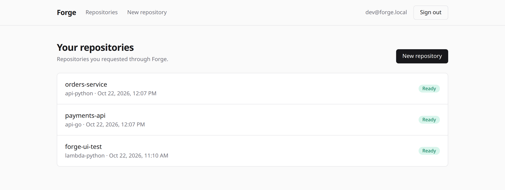
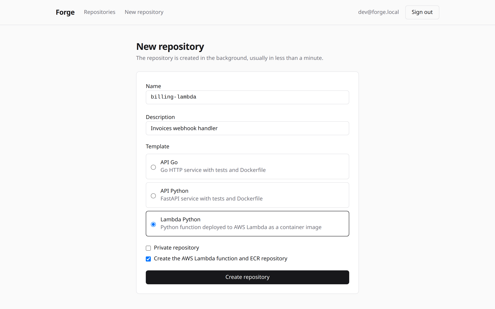
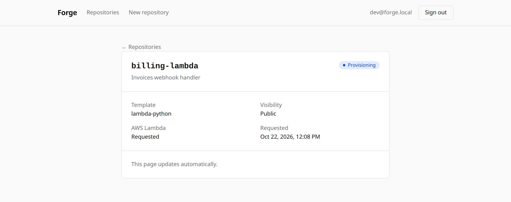
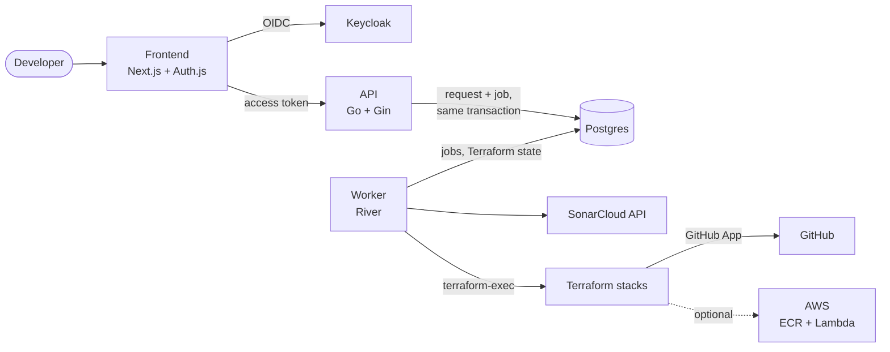

# Forge

[](https://github.com/murops/forge/actions/workflows/ci.yml)

Self-service platform where developers sign in with SSO, pick a template and get a GitHub repository with CI, security scans, SonarCloud and protected branches ready from the first commit.

It is a public, from-scratch version of an internal developer platform I built at work, using only generic templates and a demo organization ([murops-forge](https://github.com/murops-forge)).



| New repository | Provisioning |
| --- | --- |
|  |  |

## What a new repository gets

- Code from one of the templates: [Go API](https://github.com/murops-forge/template-api-go), [FastAPI](https://github.com/murops-forge/template-api-python) or [Python Lambda](https://github.com/murops-forge/template-lambda-python)
- `main`, `homol` and `desen` branches with rulesets: `main` and `homol` only change through pull requests that pass the `test`, `trivy` and `sonar` checks, `desen` can't be deleted or force pushed
- CI with tests, Trivy on the Dockerfile and the image (results in the Security tab) and a SonarCloud quality gate on pull requests
- A SonarCloud project, created before the repository so the first push is already analyzed, and bound to the repository once it exists, so importing the repository from SonarCloud's UI reuses it instead of creating a duplicate with automatic analysis
- Dependabot opening updates against `desen`
- Optionally an ECR repository, a Lambda function running a placeholder image and an IAM role the repository assumes through GitHub OIDC to deploy, with no AWS keys stored anywhere

[forge-demo-python](https://github.com/murops-forge/forge-demo-python) was created by Forge, its [first pull request](https://github.com/murops-forge/forge-demo-python/pull/1) shows the required checks and the SonarCloud gate.

## Architecture



1. The frontend signs the user in against Keycloak. The tokens stay in the encrypted session cookie and only the Next.js server uses them to call the API.
2. The API validates the token, stores the request and enqueues the job in the same Postgres transaction, so there is never a request without a job or the other way around.
3. The worker picks the job, creates the SonarCloud project and runs `terraform apply` in a workspace named after the repository, with the state in the same Postgres. Then it binds the SonarCloud project to the new repository; a failed binding only logs a warning, since the CI analysis works without it. Failures are retried with backoff and the request is marked as failed after the last attempt.
4. The frontend polls the request until it is ready and links to the new repository.

## Design decisions

- **Postgres as the queue ([River](https://riverqueue.com)) instead of Kafka.** Enqueueing inside the request transaction removes the dual write problem, and the platform has one less service to run. Retries, backoff and a UI come with River.
- **Terraform run by the worker with [terraform-exec](https://github.com/hashicorp/terraform-exec).** The same modules are tested with `terraform test` and mocked providers, and the `pg` backend keeps the state next to the requests. GitHub and AWS are separate stacks with separate state, so a repository without Lambda never needs AWS credentials. The providers are baked into the worker image, nothing is downloaded at runtime.
- **GitHub App instead of a personal token.** Installation tokens are short lived and limited to the organization.
- **sqlc and goose instead of an ORM.** Queries are plain SQL checked against the migrations at generation time, and migrations are versioned files run by a dedicated `migrate` step.
- **Rulesets only on public repositories by default.** The demo organization is on the free plan, which only enforces rulesets on public repositories. `GITHUB_PRIVATE_RULESETS=true` enables them for private ones on paid plans.

## Running locally

Requires Docker and make.

```bash
cp .env.example .env
make up
```

| Service | URL |
| --- | --- |
| Frontend | http://localhost:3000 (user `dev`, password `dev`) |
| API | http://localhost:8000 |
| Keycloak | http://keycloak.localhost:8080 (admin `admin` / `admin`) |
| River UI | http://localhost:8081 |

By default the worker runs with `PROVISIONER=dryrun`, which only logs what it would create. To create real repositories:

1. Create a GitHub App in your organization with these repository permissions: Administration, Contents, Variables and Workflows (read and write). Install it on the organization with access to all repositories.
2. Fill `PROVISIONER=terraform`, `GITHUB_ORG`, `GITHUB_APP_ID`, `GITHUB_APP_INSTALLATION_ID`, `GITHUB_APP_PRIVATE_KEY_PATH` and `FORGE_UID` in `.env`.
3. Optionally fill `SONAR_TOKEN` and `SONAR_ORGANIZATION`, and create the same `SONAR_TOKEN` secret and `SONAR_ORGANIZATION` variable at the organization level for the templates' CI.

## Kubernetes

The Helm chart in [charts/forge](charts/forge) deploys the API, the worker and the frontend, and runs the migrations as a pre-install/pre-upgrade hook (a PreSync hook in Argo CD). Images and the chart are published to GHCR from `main`:

```bash
helm install forge oci://ghcr.io/murops/charts/forge -n forge --create-namespace -f my-values.yaml
```

The chart never holds credentials. The database URL, the frontend auth secrets and the GitHub App key come from existing Secrets, so they can be managed by Sealed Secrets or External Secrets. Pods run as non-root with a read-only root filesystem and no service account token, and the frontend is exposed through a Gateway API `HTTPRoute`.

## Project layout

```
backend/            Go API, worker and migrations (cmd/forge, internal/*)
frontend/           Next.js app
infra/modules/      github-repository and aws-lambda Terraform modules, with tests
infra/stacks/       root modules the worker applies, one workspace per repository
deploy/             Keycloak realm and Terraform CLI config used by the worker image
charts/forge/       Helm chart, with unit tests and the kind e2e test in ci/
compose.yaml        local stack
```

## Tests and CI

```bash
make test        # Go and frontend unit tests
make tf-test     # terraform test for every module and stack
make lint        # go vet, terraform fmt, ESLint and TypeScript
make chart-test  # helm lint and helm-unittest
make chart-e2e   # installs the chart on kind and creates a repository in dryrun
```

The CI runs the same checks, verifies the sqlc generated code is up to date, lints the workflows and builds the three images. The chart is validated with kubeconform and installed on a kind cluster, where the e2e test signs in against Keycloak and waits for the worker to finish a request. Images and the chart are only published after all of that passes. Trivy fails the build on fixable HIGH or CRITICAL findings in the Dockerfiles, the Terraform code and the images. The Terraform binary and providers inside the worker image are upstream binaries, so they are reported in the Security tab without failing the build, and Dependabot keeps their versions up to date.
